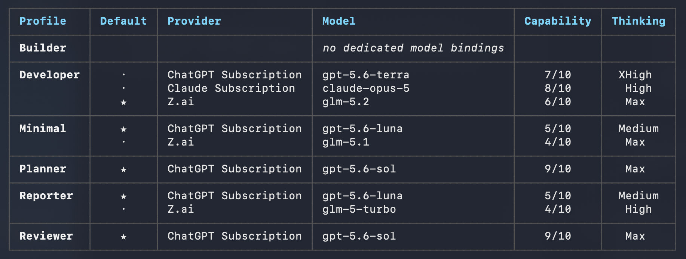

# Model Bindings

A **model binding** is the explicit authorization that connects one agent profile
to one model. It is the single mechanism that turns "which agent" and "which
model" into one routing decision, including when `/goal` chooses to delegate
a task. Direct `/goal` execution does not require a binding or a sub-agent.

Read this page before configuring delegation. Profile concepts and the
delegation lifecycle are in [agents.md](agents.md).

## The Three Concepts

| Concept | What it is | Where it is defined |
| --- | --- | --- |
| **Agent profile** | *Who* does the work: role, instructions, tools, skills | `~/.zencode/agents.json`, edited in `/setup` |
| **Model binding** | *With which model*, at *which capability* and *thinking* level | Per profile, inside the same profile record |
| **Workflow task** | *What* has to be done, with a complexity of 1–10 | Session task graph, created by `/plan`, `/goal`, or `tasks.create` |

Delegation is the act of matching the three: a task of a given complexity is
assigned to a role-compatible profile, through one of that profile's authorized
bindings.

## Reading the Bindings Table

The bindings table is shown in `/setup`, listing every configured profile with
its authorized bindings:



| Column | Meaning |
| --- | --- |
| **Profile** | The agent profile. `✱` marks the profile selected in the current session. |
| **Default** | `★` is the profile's default binding, `·` is an additional authorized binding. |
| **Provider** | The provider that serves the model (`ChatGPT Subscription`, `Claude Subscription`, `Z.ai`, any OpenAI-compatible endpoint). |
| **Model** | The model authorized for that profile. |
| **Capability** | Routing strength 1–10 of *that profile/model pair*. |
| **Thinking** | Reasoning effort configured for that binding, validated against the model. |

Reading the screenshot row by row:

- **Builder** shows `no dedicated model bindings`. It stays selectable with
  `/agents` and can still be delegated through the legacy fallback, but it is
  **not** a candidate for capability-based delegation routing.
- **Developer** has three bindings across three providers (7/10, 8/10, 6/10).
  The `★` on `glm-5.2` makes it the profile default for direct/profile-selected
  sessions. Delegation still names one binding explicitly.
- **Minimal**, **Planner**, **Reporter**, and **Reviewer** each expose the
  bindings appropriate to their role — one for the single-model profiles, two
  for those that can trade cost against strength.

The same profile can therefore appear at very different capabilities: capability
belongs to the **binding**, never to the profile alone.

## Capability vs Complexity

- **Capability (1–10)** is set per binding in setup. It answers: how strong is
  this profile when it runs on this model?
- **Complexity (1–10)** is set per task with `tasks.create`. It answers: how hard
  is this unit of work?

Guideline for both scales:

| Range | Task complexity | Typical binding |
| --- | --- | --- |
| 1–3 | Lookup, single-file edit, mechanical change | Small/fast models |
| 4–6 | Multi-file implementation, focused analysis | Mid-tier models |
| 7–10 | Architecture, cross-system integration, deep reasoning | Frontier models |

## Selection Policy

The coordinator applies these rules **in order**, and never picks by capability
alone:

1. Determine the task type and the tools it requires.
2. Exclude profiles whose role or constraints are incompatible — never assign
   implementation to a read-only `Planner` or `Reviewer`.
3. Do not delegate when the child's effective tool grant cannot perform the work.
4. Among that profile's authorized bindings, choose the **lowest capability that
   is greater than or equal to the task complexity**.
5. If no binding of that profile reaches the complexity, use its highest binding
   and report the capability gap explicitly.

Worked example against the table above — a complexity 6 implementation task:

- `Planner` and `Reviewer` are excluded at step 2 (read-only roles).
- `Builder` is excluded because it has no bindings.
- `Minimal` tops out at 5/10, below the required complexity.
- `Developer` is role-compatible; its lowest qualifying binding is `glm-5.2`
  at 6/10, so that binding wins over the 7/10 and 8/10 options.

The runtime only advises when complexity exceeds the chosen capability; the
coordinator remains responsible for the explicit profile and binding choice.

**Role-based delegation.** An item with `profileRole` names no profile or
binding: the runtime applies these rules to the profiles of that role associated
with the sub-agent's project (see [Project Agents](agents.md#project-agents)),
choosing the profile and binding pair across all their delegatable bindings. The
lowest capability that meets the complexity wins, or the highest with a
capability-gap note when none does; ties go to the role's system profile, then
to manifest order, then to roster order (model ID, then binding ID). When no
candidate has a delegatable binding, a candidate without configured bindings runs
on the main session model (system profile first); otherwise the item is rejected.
With a `taskID`, the task's complexity applies and any gap is reported after the
claim.

## Direct Work vs Delegation

Bindings are also a **cost ladder**: a lower capability means a cheaper model,
and work the coordinator performs directly is billed to the main session model,
which normally sits at the top of that ladder. The coordinator therefore weighs
cost, not just speed, when deciding whether to delegate:

- When a role/tool-compatible profile exposes a binding that is cheaper than the
  main session model and still meets the task complexity, the task is delegated
  to the cheapest sufficient binding even if doing it directly would be faster.
  The coordinator keeps the brief (files, constraints, acceptance criteria),
  coordination, and validation of the result.
- Only complexity-1 work whose context is already in hand stays direct.
- When no compatible profile has bindings, delegation saves nothing: the
  coordinator works directly unless real parallelism, separate ownership, or a
  different tool grant justifies a sub-agent.

The same rule applies inside `/goal`, in other task graphs, and for single
delegations outside a task graph.

## What The Model Sees

Profiles with at least one binding that has both a model and a capability are
published in the system prompt as the delegation roster:

```text
Delegatable agent profiles and model bindings:
- Developer [read-write; tools: shell, files, text, ...]: Developer agent. Implement the user's request, ...
  - provider: Z.ai | model: glm-5.2 | pass model: binding:developer-fast | capability: 6/10 | profile default
  - provider: ChatGPT Subscription | model: GPT-5.6 Terra | pass model: binding:developer-terra | capability: 7/10
  - provider: Claude Subscription | model: Claude Opus 5 | pass model: binding:developer-opus | capability: 8/10
```

A binding without a capability is omitted. Bindings are also intersected with
the authoritative `settings.json` model catalog: removed or unauthenticated providers, missing
models, duplicate aliases, and bindings that converge ambiguously on one model
are not advertised. A profile whose bindings are all omitted disappears from
the usable roster — which is why `Builder` in the screenshot is never routed to
automatically. When no routable binding exists, the prompt says so explicitly
and instructs the model not to call `agent.create`. The complete section is
omitted only when delegation itself is unavailable or the session pins one model.
An `organizer` coordinator gets a `Delegation by role:` section instead, which
lists the roles of its visible profiles and no bindings (see
[Organizer](organizer.md#delegated-work)).

The `binding:<id>` token is the only reference advertised for `model`. Its
namespace cannot collide with a model ID or provider slug. Provider and model
display names are explanatory only and must never be substituted into the tool
call.

## Resolution Rules

The model-visible `agent.create` schema exposes one provider-neutral shape:

```json
{"agents":[{"profile":"Developer","model":"binding:developer-fast","taskID":"task-a","prompt":"Implement the scoped change"}]}
```

It resolves the profile first, then the binding **inside that profile and one
authoritative model-catalog snapshot**:

| Profile configuration and request | Result |
| --- | --- |
| Has bindings, no `model` | Rejected — delegation never silently uses the profile default. |
| Has bindings, matching `binding:<id>` | The explicitly requested, currently routable binding is used. |
| Has bindings, stale, ambiguous, capability-less, or non-matching `model` | Rejected before reservation or task claim. |
| No bindings, no explicit model | Compatibility-only programmatic fallback: the child inherits the exact parent provider/model and stays out of the routing roster. |
| No bindings, explicit model | Rejected — no authorized binding exists. |
| No profile resolved, explicit model | Rejected — a model reference always requires a profile. |
| `profileRole`, no `model` | The runtime resolves the role to a profile associated with the sub-agent's project and selects its binding from the complexity policy (see [Selection Policy](#selection-policy)). |
| `profileRole`, with `model` | Rejected — a role never names a binding; use `profile` with its `model`. |

Every rejection happens while the complete batch is prepared, before a taskless
reservation or task claim. The resolved provider selection is carried to the
backend; backend creation does not repeat a global lookup, so two providers may
safely expose the same raw model slug. Historical root fields and aliases remain
accepted for wire compatibility, but blank aliases cannot mask valid values and
conflicting or malformed aliases are rejected.

## Bindings In `/goal`

`/goal <goal>` works until completion or a genuine blocker and keeps a persistent
task DAG for both direct and delegated work. Bindings apply when it delegates:

1. The current agent creates the task graph, assigning each task a `complexity`.
2. For each task it chooses direct execution or useful delegation. For delegated
   work it picks a role-compatible profile and its lowest qualifying binding.
3. It claims delegated work atomically with a canonical `agent.create` `agents`
   item containing `taskID`, `profile`, and `model` only for configured bindings.
   Direct work instead uses `tasks.update` from `pending` to `in_progress`.
4. It validates results before completion. Negative delegated validation records
   failure, followed by `tasks.retry` and a **new** direct or delegated attempt.
   Never use `agent.message` to reopen a completed delegated attempt.

Mapping the screenshot onto a typical workflow graph: analysis tasks go to
`Reporter`, routine implementation to `Developer` on `glm-5.2` (6/10), delicate
refactors to `Developer` on `claude-opus-5` (8/10). `Planner` and `Reviewer`
remain available for tasks that must *produce* a plan or an intermediate
read-only assessment — in `/goal` the overall planning and the final review
stay with the coordinator itself, unlike `/plan` and `/review`.

## Configuring Bindings

```text
/setup         # add, edit, or remove bindings per profile
```

Setup asks for, per binding:

- **Model** — the specific provider/model authorized for the profile.
- **Capability (1–10)** — routing strength; setup always stores a value, with `5`
  as the default.
- **Thinking** — reasoning effort, validated against the model's supported
  options.
- **Default** — one binding per profile is marked `★` for direct/profile-selected
  sessions. `agent.create` still requires an explicit `model` reference.

A binding with no capability at all is only possible in a hand-edited or legacy
`agents.json`; it is excluded by both the delegation roster and runtime.

When setup persists provider/model changes, it reconciles `agents.json` against
the same provider-safe catalog. Orphaned and ambiguous bindings are removed,
surviving legacy slug references are upgraded to canonical provider-qualified
model IDs, and a removed default is recalculated deterministically. The bulk
binding editor uses the setup session's in-memory manifest, so changes made
earlier in the same setup run are visible immediately. Provider, credential,
profile, and binding edits are staged in the setup session and written only at
finalization; cancelling or exiting before finalization does not rewrite either
manifest, so it cannot roll back or overwrite another process's update. The
finalizer prevalidates and pre-encodes both manifests, rejects a concurrent change
since setup began, serializes ordinary settings/profile writers with one
cross-process lock, and uses per-file atomic replacement plus compare-and-swap
rollback. A restrictive, directory-synchronized rollback-first journal restores
an interrupted two-file finalization before the next coordinated delegation read
or manifest write; its durable unlink is the commit point.

Then inspect the result:

```text
/setup          # add, edit, or remove bindings; the summary shows every profile's authorized bindings
/agents         # switch profile (role, tools, instructions, default binding)
/models         # override the model for the current session only
```

`/models` is independent from `/agents` and never filters the catalog. A manual
model selection overrides the profile default for the **active session**; it
never widens what a delegated sub-agent may run on, because every sub-agent with
a resolved profile is still limited to that profile's authorized bindings.

> **Configure at least one binding for every profile that should receive
> delegated work.** Without it, the profile is invisible to capability routing,
> exactly like `Builder` in the screenshot.

## Binding Presets

`binding-presets.json` keeps the bindings of each provider in one hand-edited
file and applies them to every profile in a single step. It ships with the
ZenCODE sources at `Sources/ZenPackageMetadata/binding-presets.json`; `/setup`
reads it from the same source checkout it builds ZenCRON and optional features
from: the checkout `zen` was built from, otherwise the installer copy under
`<support>/source`, otherwise the current directory. ZenCODE only reads it: it
never creates it, writes it, or generates an example.

```json
{
  "version": 1,
  "providers": {
    "Claude Subscription": {
      "developer": {
        "defaultModelBindingID": "claude:claude-opus-5-5",
        "modelBindings": [
          { "id": "claude:claude-haiku-5-5", "modelID": "claude:claude-haiku-5-5", "modelProvider": "Claude Subscription", "capability": 2, "thinkingSelection": "low" },
          { "id": "claude:claude-opus-5-5", "modelID": "claude:claude-opus-5-5", "modelProvider": "Claude Subscription", "capability": 8, "thinkingSelection": "high" }
        ]
      },
      "reviewer": { "modelBindings": [] }
    },
    "OpenRouter": { "developer": { "modelBindings": [] } }
  }
}
```

A binding has the same fields as in `agents.json`. `version` must be `1`; any
other version is an error, as is invalid JSON.

Rules, applied to every profile when you apply the presets (see below):

- **Providers.** The keys of `providers` are provider names, as in the
  `modelProvider` of `agents.json`. Only the providers configured in
  `settings.json` that have a block in the file can be used, and you choose which
  ones in a menu when you apply the presets (see below); names are compared
  ignoring case, accents, and surrounding spaces, and empty keys are ignored.
- **Order.** The order of the provider keys in the file is the priority order,
  not the order of `settings.json` and not the order of the selection.
- **Profiles.** Inside a provider, a key is a profile id or a role. The entry
  written under the profile's id wins; the entry written under its role is the
  fallback, so a custom profile can use its role's preset.
- **Result.** The bindings of every applicable provider are concatenated. The
  default is the first non-empty `defaultModelBindingID` in file order (if it
  names no resulting binding, the usual profile default rule applies).
- **Replacement is total.** A profile with no applicable entry ends up with no
  bindings. Its other fields are untouched. Bindings whose model is not in
  `settings.json` are dropped on save, exactly as for bindings edited by hand.

Presets are never applied on their own. There is one place to apply them, and one
to clear bindings, both in `/setup` > Agent model bindings:

- **Apply binding presets** (right after **Done**) first opens a menu to choose
  the providers to use. It lists only the configured providers that have a block
  in the file, in file order, all pre-checked (so **Enter** alone uses them all),
  and it appears even when there is a single one. It then replaces the bindings
  of all agents in the setup session with the presets of the checked providers
  (the replacement is total, as above). Confirming with no provider checked, or
  pressing `Esc`, returns to the Agent model bindings menu with the agents
  unchanged. A missing source checkout is reported, a missing or invalid file is
  reported with its path, and so is a file with no block for any configured
  provider; in all these cases the agents stay unchanged and the menu is not
  shown.
- **Reset** (right below it) removes every agent's bindings and default binding
  at once, with no confirmation, whatever their source.

Neither writes anything until **Done**; `Esc` on the Agent model bindings menu
discards the unsaved changes.
