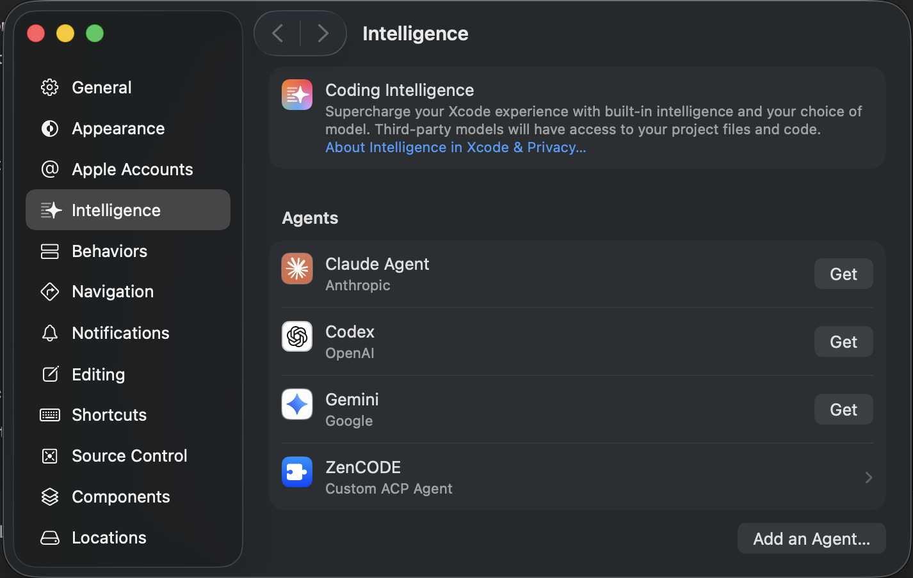
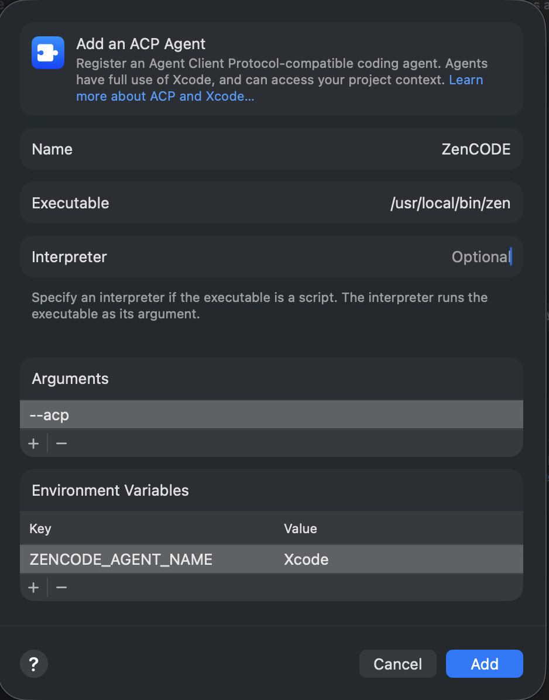

# Xcode ACP setup

Xcode can run `zen` as an ACP stdio coding agent.

## Prerequisites

1. Install `ZenCODE` and run the setup once. `zen` does not open it
   automatically:

   ```bash
   zen --setup
   ```

2. If you want the optional Xcode-native tools, install their macOS-only feature package:

   ```bash
   zen --install-features xcode-tools
   ```

   The Xcode MCP implementation is not part of the `zen` executable or the root
   SwiftPM graph. It runs through the separately installed
   `xcode-tools-feature` process.

   Xcode also passes its own `xcode-tools` MCP server to every ACP session.
   With the `xcode-tools` feature installed and enabled, `zen` does not start
   that server, even when the session's agent does not select the feature:
   the session uses the feature's tools, named `xcode.*`, so `zen` opens a
   single connection to Xcode, which asks for the MCP consent once, and the
   changes the tools make to files show their diffs and artifacts like local
   writes. Without the feature installed, the session uses Xcode's own
   server, with tools named `xcode-tools.*` and no diff or artifact for the
   changes they make to files.

3. Make sure the recommended agents exist. The setup can create `Developer`, `Builder`, `Planner`, `Reviewer`, and `Reporter`.
4. Verify the executable path:

   ```bash
   which zen
   ```

   The default script install usually returns `/usr/local/bin/zen`.

## Add `ZenCODE` in Xcode

1. Open **Xcode**.
2. Open **Xcode > Settings…**.
3. Select **Intelligence**.
4. In **Coding Agents**, click **Add an Agent**.



## Configure the agent

In the agent editor, set:

- **Name**: `ZenCODE`
- **Executable**: the full path returned by `which zen`, for example `/usr/local/bin/zen`
- **Arguments**: `--acp`
- **Interpreter**: leave empty

To pin a specific agent profile, add this environment variable:
- **Name**: `ZENCODE_AGENT_NAME`
- **Value**: `Developer`



Save the agent.

## Recommended configuration

Use this final configuration:

```text
Name: ZenCODE
Executable: /usr/local/bin/zen
Arguments: --acp
Interpreter: <empty>
Environment:
  ZENCODE_AGENT_NAME=Developer
```

## Agent mentions and commands in the chat

> **A leading `@Agent` mention changes the agent of the whole conversation.**
> `@Planner analyze the parser` does not send a message to a Planner: it makes
> `Planner` the agent of this Xcode conversation, then sends `analyze the
> parser` to it. Every later message also goes to `Planner`, with that
> profile's tools (the `Planner` is read-only), until another mention such as
> `@Developer` switches back.

How a mention works:

- It must be the first word of your message. It matches the id, name, or
  display name of an agent profile, ignoring case, accents, and punctuation:
  `@planner` and `@Planner` are the same mention.
- The conversation takes the profile's instructions, tools, and role, and the
  profile's own model when it sets one. A mention does not update the model
  menu in Xcode.
- The rest of your message is the prompt. The model receives it after the
  context Xcode attaches (project structure, open file), without the mention.
- The change lasts for this conversation only. A new conversation starts again
  with the agent set in `ZENCODE_AGENT_NAME`, or the project's default
  Developer agent.
- A mention can come before a command, such as `@Developer /goal fix the
  build`. The command then runs as that agent.
- A name that matches no profile (`@Nobody …`) is not a mention: the whole
  message goes to the current agent as ordinary text.

Do not confuse it with:

| You type | Effect |
| --- | --- |
| `@Planner analyze X` | Makes `Planner` the agent of the conversation and sends it `analyze X`. |
| `/plan analyze X` | Starts the planning workflow: a read-only Planner sub-agent asks its questions and writes a plan to approve, save, and implement. The conversation's agent does not change. |
| `@agent-name …` in the terminal or in Telegram | Sends a live message to an active agent in the shared chat. It does not change the agent. |

Commands picked from the Xcode command menu (`/goal`, `/plan`, `/review`,
`/tasks`, `/changes`, `/undo`, and `/telegram` while the settings enable it)
run as commands and never reach the model as plain text. Xcode sends its
context (a `<system-reminder>` and the `Project structure …` block) as separate
text blocks before your text, so ZenCODE reads the command, or the mention,
from your own text. A command that starts a turn still passes Xcode's context
to the model before its prompt.

## Troubleshooting

- **Xcode cannot start the agent**: use an absolute executable path, not just `zen`.
- **Xcode tools are unavailable**: install or update `xcode-tools` with `zen --install-features xcode-tools`, keep Xcode open, enable the package in `/tools`, and approve any MCP/automation prompt shown by Xcode.
- **No model is configured**: run `zen --setup` in Terminal, then start the session in Xcode again.
- **“This provider requires authentication” in Xcode 27 beta 3**: update ZenCODE, select **Continue with ZenCODE**, then retry the session. This is an Xcode ACP compatibility acknowledgment, not provider authentication.

## Standard ACP presentation: scope and verification

ZenCODE emits standard ACP v1 `plan`, `tool_call`, `tool_call_update` and
`available_commands_update` updates. Only the supported, capability-gated `goal`,
`review` and `plan` commands are advertised, plus `tasks`, which reads and
controls the session task graph (`/tasks`, `/tasks show <id>`, `/tasks get <id>`,
`/tasks retry <id>`, `/tasks cancel <id>`, `/tasks clear`), and `telegram` while
the settings enable it; textual command responses remain the fallback. The
client's Tasks section follows the graph by itself. A turn publishes it through
its own update pipeline, so the `plan` update never overtakes the content that
turn produced; outside a turn the session keeps an observer of its task-graph
events for its whole life, and a turn that ended by cancellation reconciles the
section at its end. A section is written once per change, and an older graph
never replaces a newer one, while `/tasks` answers with the graph as text on
demand. Creating a delegated agent is distinct from that agent's execution and
from task validation. Failed/blocked/cancelled plan entries are explicitly
labelled because ACP's plan status enum has no matching failure values.
Taskless idle or standby alone is not evidence of successful execution. The
`title` of the
`tool_call_update` that completes a tool call, a delegated agent's included, ends
with the call's elapsed time as the terminal shows it (` · 1.25s`); the
`tool_call` that creates it keeps the plain title.

Diffs are **per operation**, not a reconstructed end-of-turn summary. When Xcode
advertises the standard ACP filesystem capabilities, `local.read` /
`local.multiRead` read client text, and `local.write` / `local.edit` /
`local.multiEdit` / `local.replace` write through the client rather than bypassing
its buffers. The latter three require both read and write capabilities. No extra
agent, MCP extension or Xcode setting is required. The tool descriptions direct
text edits to these client-backed tools; project structure, builds, tests and
diagnostics continue to use the Xcode tools. Other local operations (including
append, applyPatch, move and delete) retain their filesystem implementation.

For client writes, a complete known preimage is rechecked before the write and the
acknowledged result is reread before emitting a standard diff. This is not atomic
against concurrent editor changes: ACP v1 has no revision-conditional write. A
missing/unreadable preimage is unknown, not proof that a file was absent. Client
errors never fall back to disk; failed verification after an acknowledged write
suppresses the diff without falsely reporting that the write failed. Client-owned
parent-directory handling and actual UI rendering remain client behavior. The
capabilities are checked on every connection and are not persisted.

Without negotiated client access, diffs are **per local operation**. The
local write/edit/replace/multiEdit/append/applyPatch/delete/move paths capture
actual before/committed text; delegated tool rows have agent-qualified IDs. Binary
or unreadable files, directories, failed/rolled-back operations, and opaque
shell/Git/MCP effects retain text instead of inventing a diff. A move is represented
as deletion at the source and a write at the destination. Partial rollback failures
retain their existing explicit error text. No patch string is passed off as a
file's old or new contents. Capture is limited to verified regular files, at most
64 KiB per text and 256 KiB per operation. Snapshot reads and emitted old/new
content have separate cumulative 256 KiB budgets; oversize evidence falls back to
text without truncation. Ordinary tool results without operation evidence keep
only their existing output content, without synthetic diff-unavailable notices.

Concurrent known local commits are serialized. An overlapping opaque execution
suppresses reliable-diff presentation. **After a successful background exec launch,
that conservative suppression lasts until this ZenCODE process exits**, even if
the job later finishes: there is no trustworthy end-of-writers signal here.
Unrelated external writers are outside the in-process attribution guarantee.

Permission dialogs use the root ACP session for delegated requests, with distinct
per-agent consent keys and root cleanup. Only offered `allow_once`/`allow_always`
choices authorize; cancellation takes precedence over contradictory selection
fields. Legacy response envelopes are still decoded, but an invented `allow_*`
option is not authorization. Full-access policy and persistent local.exec consent
remain unchanged. Pending tool rows do not claim execution while permission is
still being requested.

Wire/schema tests **do not demonstrate that Xcode renders these views**. Rendering
must be verified independently in a real Xcode session (plan replacement/clear,
automatic plan updates during and between turns, `/tasks`, parallel agents and
retry, file diff, command catalog, permission cancel/deny).
No live-provider/network exercise or Xcode UI verification accompanies these source
changes. Added focused suites: `ACPCommandRoutingTests` (the plan of a turn,
outside a turn, and with `/tasks`), `ACPStandardPresentationTests`,
`ACPPresentationLifecycleIntegrationTests` and `OperationFileChangeTests`; the new
regressions require independent execution before release. Presentation observers
are prompt-scoped for text and tool rows and do not claim live updates while no
ACP prompt is active; the plan is the exception, published by the session's own
task-graph observer between turns and by an explicit `/tasks` with its answer.
The next prompt reattaches existing runtime observation even when the root emits
only text. Each taskless runtime execution has a separate transient identity;
previous output cannot complete a later running turn. Close drains accepted
updates before replying; replacement prompt/session fences suppress stale output.
